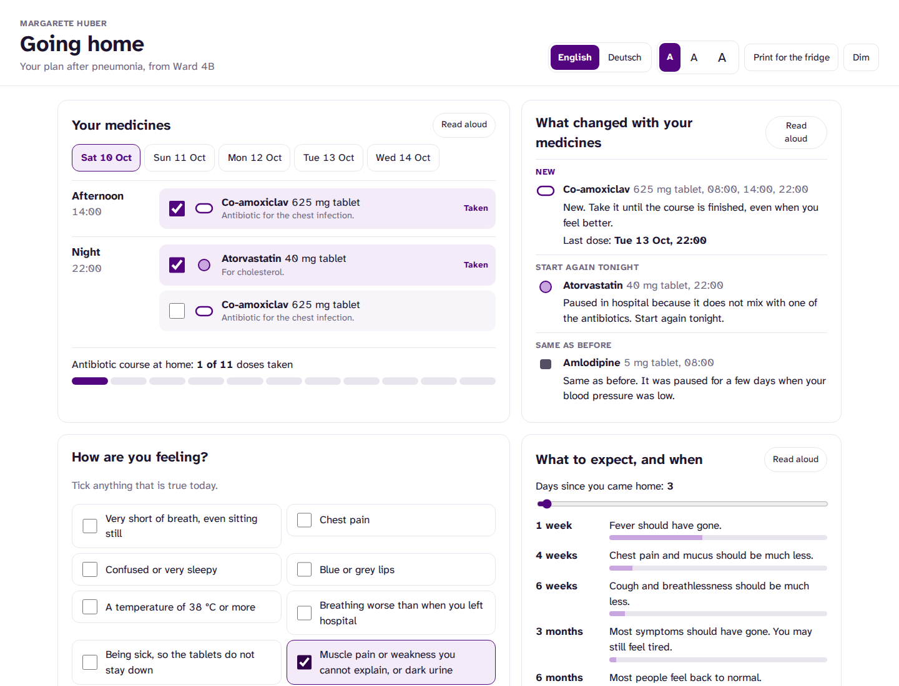
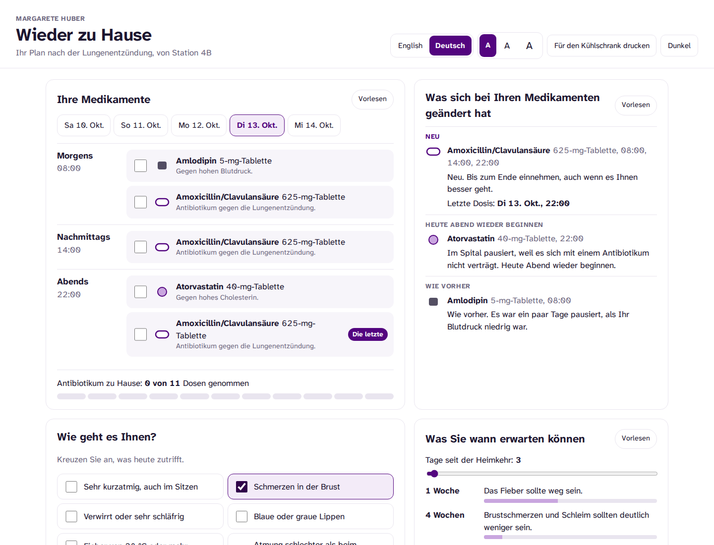
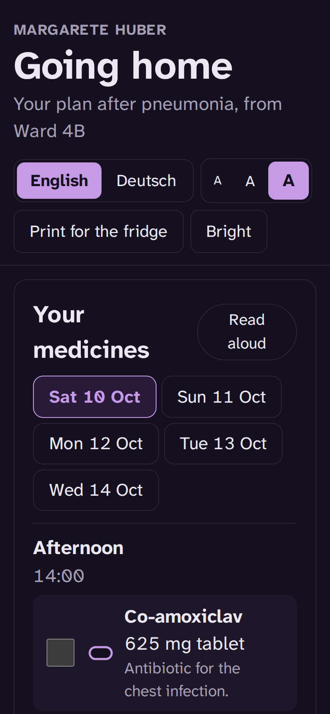

# Going home

Live: https://discharge-companion-lovat.vercel.app

A discharge companion for Margarete Huber, the same fictional patient as the rest of the suite,
on the day she leaves Ward 4B after pneumonia. Everything she needs for the next six weeks on
one page: which tablets to take and when, what changed and why, when to get help, what recovery
usually looks like, and her follow-up. In English and in Austrian German, because she lives in
Vienna.



Most readmissions after pneumonia are not new problems. A course is stopped early, a paused
medicine is never restarted, or a warning sign is read as normal tiredness until it is not.
The discharge letter usually contains the right information, written for her GP. This page is
the same plan, written for her.

- **Medicines by the day.** Tabs for Saturday to Wednesday, each split into morning, afternoon
  and night, with a tick box per tablet. The ticks are remembered on the device. The
  antibiotic shows as a bar of 11 home doses, and the very last one is marked, so the course
  does not quietly stop when she feels better.
- **What changed, and why.** Each medicine is new, restarted or the same as before, with one
  reason in plain words. Atorvastatin was paused because it does not mix with clarithromycin,
  and starts again tonight. Amlodipine was paused while her blood pressure was low. The German
  view uses the names on an Austrian pack (Amoxicillin/Clavulansäure, Amlodipin).
- **How are you feeling?** Twelve tick boxes, emergency signs first. The most serious tick
  decides the advice: call 144 for an ambulance, call the GP today or 1450 out of hours, or
  this is normal after pneumonia. The urgent list includes the signs her own medicines make
  more likely: muscle pain or dark urine on a statin, dizziness on standing with amlodipine,
  a rash after the antibiotic.
- **What to expect, and when.** A slider for days since coming home against the NICE recovery
  milestones: fever gone by a week, cough much less by six weeks, back to normal by six months
  for most people. Tiredness at four weeks is expected, and the page says so.
- **The next appointment.** Around 21 November: GP review and a chest X-ray.
- **For the fridge.** Print gives a one-page sheet in the chosen language.



## Joined to the record

The plan is not typed in. It is derived from the same hospital record as the other projects,
and tests check that the two agree:

- The antibiotic ends on Tuesday 13 October at 22:00, the date the discharge note names, which
  makes seven calendar days from the first intravenous dose.
- The first home dose is at 14:00 on the day of discharge, six hours after the last ward dose:
  no double dose and no gap.
- Atorvastatin restarts with the dose the record planned for that evening. Amlodipine
  continues the morning after it was restarted on the ward.
- New, restarted and same are worked out against the medicines on her triage note.

## Plain language, tested

Every patient-facing sentence exists in both languages, and the tests read the English:

- Flesch reading ease of 70 or more across the page (plain English is 60 to 70).
- No sentence longer than 15 words.
- The German uses Austrian terms: Spital, Rettung, Hausärztin, Harn, Jänner. Never
  Krankenhaus.

## Built for a 74-year-old after a hospital stay

- Three text sizes, which scale the whole layout rather than just the type.
- Read aloud for each section, through the browser's speech, in en-GB or de-AT.
- Large tick targets and a single column at phone width.
- Dim display follows the system or the button.
- Amber and red mean only urgent and emergency. Purple means something to press.



The printed fridge sheet: [docs/fridge-sheet-de.pdf](docs/fridge-sheet-de.pdf).

## Tested

98 tests: 21 for the plan, plus the shared record and clinical scores (77) from the patient timeline.

- The plan joins up with the record, as above.
- The daily schedule: three antibiotic doses on a full day, only the regular medicines once
  the course ends, and only what is left after 11:30 on the day of discharge.
- When to get help: any emergency tick wins whatever else is ticked, every urgent sign goes to
  the GP or 1450, and the emergency questions come first.
- Recovery: the milestones are in order and the follow-up date crosses into November correctly.
- Plain language and both languages, as above. No em dashes.

The month test earned its place. The shared record only ever lived in October, and its date
label printed six weeks after discharge as "Sat 52 Oct". It now goes through a real calendar.

## Run it

```bash
npm install
npm run dev
npm test && npm run lint && npm run typecheck
npm run build          # static site in dist/
npm run build:single   # one self-contained HTML file in dist-single/
```

## The suite

One patient, one design system, six views of the same admission:

- [Patient timeline](https://github.com/Henrycarto/patient-timeline): the admission as one
  linked record.
- [Clinical decision cockpit](https://github.com/Henrycarto/decision-cockpit): six decisions and
  what would change each one.
- [Medicine collisions](https://github.com/Henrycarto/med-collisions): every interaction window
  in her chart, and which ones happened.
- [Shift replay](https://github.com/Henrycarto/shift-replay): a night on the ward and a
  60-second handover.
- [Hospital flow twin](https://github.com/Henrycarto/flow-twin): the constraint behind the bed
  she waited for.
- Going home: this one.

## Not medical advice

A fictional patient and a demonstration of interface design. Not medical advice and not a
medical device. Phone numbers 144 and 1450 are the real Austrian ambulance and health advice
lines; the ward number is deliberately left out.

## Author

Samuel Henry Mba
